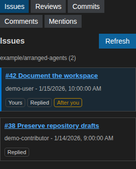

GitHub activity
===============

Select **Github** at the top of the right panel. It follows the selected
repository and provides six views:
**Issues**, **Reviews**, **Oldest PRs**, **Commits**, **Comments** and **Mentions**.
GitHub reads are independent of Copilot and do not consume model requests.

Issues and reviews
------------------

Issues and pull requests you created have a distinct background and a **Yours**
marker. **Replied** marks discussions in which you commented or submitted a
review. **After you** indicates that another participant responded after your
latest contribution.

   Example issues and participation indicators using demo data.

Read an issue or pull request
-----------------------------

Click an issue or pull request title to read its description and discussion
comments in the main panel. Markdown is rendered locally; comments are loaded
across all pages. This is a local Markdown view, not an embedded GitHub website:
submitted reviews, inline review threads and editing existing content remain on
GitHub.
It does not send anything to Copilot or change your conversation or draft.

Use **Back to conversation** to return to the chat, **Refresh** to reload the
discussion, or the **Open on GitHub** arrow icon for the full website.
The conversation's **Show issue / PR** button switches back to the open
discussion without reloading it. Returning to chat keeps the discussion and its
scroll position; an in-flight read can finish while you continue chatting.
Each issue and PR in the sidebar also has its own external-open arrow icon.
Titles always open inside the application; only the separate icon opens the
issue or PR in the browser. Links inside the reader, comment permalinks and
commits also open externally.
Changing repositories closes the reader and cancels its pending read.
Authentication and API failures appear in the reader, where you can retry.

Review a pull request diff
--------------------------

In a pull request reader, **Review PR diff** opens the changed files side by
side. It compares GitHub's merge base with the PR head, even when that branch
is not checked out locally or belongs to a fork. The commit IDs are displayed;
**Refresh** loads a new snapshot if the PR changes.

Select a file in the resizable tree and use the overview bar to see and navigate
changes across the entire file. The bar shows removed lines on the left, added
lines on the right and the currently visible portions; click it or use the
keyboard to scroll. **Previous change** and **Next change** move between
changes. Click a line to add a commit-pinned GitHub link to the review notes.
With a session open, **Send notes to agent** sends the notes and PR identity to
that session; it does not publish a GitHub review or comment.
**Back to pull request** returns to the discussion.
Notes stay with the PR in this window while you open or switch sessions.

Reading the diff uses authenticated ``gh`` and does not require an open session.
Renames retain both paths. Binary files are listed without a text comparison;
submodules cannot be displayed as text. GitHub's file-list limit is 3,000
files. Files exceeding 10,000 lines or 4 MiB of diff output are reported
instead of being truncated.

Publish a comment
-----------------

Write a Markdown comment below an issue or PR and click **Publish on GitHub**.
It posts a regular discussion comment using the account authenticated with
``gh``; it is not a PR review or inline code comment. No Copilot request is made.
Typing or pressing Enter never publishes: Enter inserts a newline.
Empty comments are disabled and comments are limited to 65,536 characters.

The form prevents duplicate submissions while publishing. Drafts are kept
separately for each repository and discussion in this window. Navigating away
does not cancel a publication already in progress. A confirmed publication
clears the submitted draft and adds the comment to the discussion.
Failures keep your text and are shown explicitly, with no automatic retry.
If publication cannot be confirmed after a connection error, check GitHub before
retrying: the server may already have created the comment.

Oldest pull requests
--------------------

**Oldest PRs** shows up to 10 open pull requests for the selected repository,
ordered by creation date, oldest first. Closed and merged PRs are excluded.
The displayed timestamp is the creation date, not the latest update.
This view shows ownership but does not load comments or reviews, so **Replied**
and **After you** indicators are not shown. Use **Refresh** to update the list;
there is no **Load more** for this fixed-size view.

Comments and mentions
---------------------

**Comments** combines your comments and submitted reviews with later responses,
including closed discussions and inline review replies. Draft reviews are not
included.

**Mentions** finds direct ``@username`` pings in descriptions, comments,
submitted reviews and inline review comments when you have not responded later
in the discussion. It excludes your own pings and team mentions. GitHub search
indexing can delay results, so **Load more** may find older entries even after an
empty page.

Commits
-------

**Commits** displays the latest 30 commits on the current local branch. A commit
opens on GitHub when a GitHub remote is available. Unpushed commits remain in the
list but may not have a corresponding GitHub page.

Fetching and ordering
---------------------

Use **Refresh** to fetch current activity and **Load more** to paginate supported
views. There is no automatic background polling. Except for **Oldest PRs**,
lists are newest-first: issues and reviews use update time, comment groups use
their latest displayed response, and commits use author date.

The panel uses the installed and authenticated ``gh`` CLI. Authentication,
permissions, rate limits and API failures are shown explicitly instead of being
represented as empty results.
