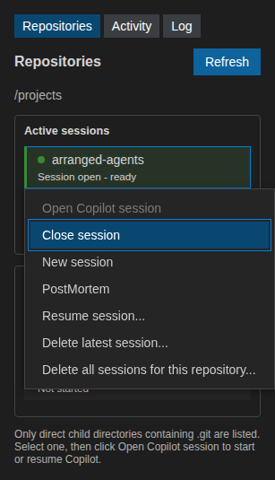

Sessions
========

Every repository can have multiple Copilot and local sessions open at the same
time. Each has its own transcript and draft; switching sessions never merges model
context. Sessions start lazily and continue independently while another session
is displayed. Selecting a repository only displays its current view and draft;
use **Add** to open an independent session in two steps: first the agent and
its model (a configured worker; the list shows where it runs), then the machine
where files are edited and commands run, with the repository path on that
machine. The second step is skipped for Copilot workers and when only one
machine is configured.
The **Session** dropdown lists all open sessions in the selected repository.
**Close** stops only the selected session, leaving its transcript available.
**Resume** lists the repository's saved Copilot sessions,
including ones started from the Copilot CLI, and resumes the chosen one; a
session started outside DevDash Agents keeps its model context but its earlier
messages are not shown. **New** closes and archives the selected conversation
and replaces it with a fresh session using the same worker and machine assignment;
other sessions remain open. Session labels show the worker and command machine.
Model and device selection stays in the Settings tab, not in this toolbar.

The compact colored timing band in the bottom message-action row shows generation
and tool durations for Copilot and local sessions. Hover over the band or a segment
for request details, per-tool totals and generation throughput in tokens per second
when token usage is available. Overlapping work occupies separate thin lanes.

Multiple application instances
------------------------------

Open separate VS Code windows for separate repository roots to run multiple
application instances. Each instance owns its Copilot CLI processes and native
workers, communicating over private standard-input/output pipes rather than a
shared listening port. Cancelling or closing one instance does not stop another
instance's processes or clear its local conversation caches.

History files are keyed by the full launch-root path, so different roots,
including directories with the same name, keep separate transcripts and drafts.
Windows opened on the same launch root share a history snapshot; the last save
wins. Model settings and downloaded weights can be shared, and simultaneous
workers still compete for the same machine's RAM and device memory.

Persistence and resume
----------------------

Closing the application stops its CLI processes and saves conversations, drafts,
the selected repository, token counts and session identifiers. Reopening with
the same parent directory restores the interface without starting Copilot.
**Resume** restores a saved Copilot SDK session and its model context.

Local inference
---------------

**Add**, then a native model worker, uses its model source, CPU/CUDA device and
machine defined in the settings panel (see :doc:`settings`).
Inference and repository execution machines can differ. Native release VSIX assets bundle a ready-to-run CPU or CUDA engine
for :doc:`supported platforms <../getting_started>`. Models are not bundled.
In a Linux x64 source checkout, the first local session builds a missing engine
automatically (about two minutes, with a progress notification).
External workers, including NPU/vendor runtimes, can be selected with
``devdashAgents.localWorkerPath``. The engine runs on
the workspace extension host, including in SSH, WSL and dev containers.

One model worker is shared by all sessions assigned to that worker,
including sessions in different repositories. Distinct worker identifiers run
independently, even for the same model and device. Each conversation has
an isolated KV cache. The worker serializes inference requests so sessions do
not overlap calls into ONNX Runtime GenAI.

The **Sessions** panel lists loaded models and their open local sessions,
including cached tokens and an approximate KV byte size, context usage and
generated tokens. Click a session to show its conversation. The panel also
shows the current device, whose button is disabled, and lets you move the model
to another detected CUDA, NPU or CPU device. The setting in :doc:`settings` selects
the device for a future model load; moving an already loaded model is done in
this panel. Automatic selection prefers CUDA, then a supported NPU, then CPU.
An unavailable device, unsupported provider, invalid model or missing chat
template produces an error; neither the model nor provider is silently
substituted.

Choosing **DISK (unload)** stops the worker and releases the model and all local
KV caches. No model or cache is written to disk. A local session stays visible,
but cannot generate until CUDA, NPU or CPU is selected in the Sessions panel;
that selection starts a fresh worker and the conversation's prompt is evaluated
again to rebuild its cache.

Use **Add**, then a native worker, to open another independent local conversation for the
same repository. Each new session saves its chosen worker and execution machine;
changing Settings does not move existing sessions. Sessions
assigned to the same worker share it with separate context caches. Choose a conversation in
the **Session** selector or the Sessions panel. Drafts, transcripts,
cancellation and context reduction belong to the selected conversation; saved
transcripts are retained across application restarts.

Only the oldest open local session can edit files or run commands, and its
normal approval requirements still apply. Additional sessions are labelled
**read-only**: they can read and search repository files, but neither edits nor
unsandboxed commands can be approved for them. Closing the editing session
promotes the oldest remaining open local session. These restrictions apply to
local tools, not to independent Copilot sessions.

Each idle local session also offers two context actions:

* **Discard oldest half** keeps the newest half of the context, preserving the
  system instructions. ONNX Runtime GenAI cannot evict leading KV entries in
  place, so this sliding-window option rebuilds the cache from retained context.
* **Compress & prefill** asks the local model for a summary, replaces the
  inference context with that summary and the system instructions, then clears
  the old cache and prefills a new one. Summary output is never executed as a tool.

Both actions target half the previous context's token count, including chat
template overhead. If the system instructions alone prevent that reduction,
the action reports an error. The displayed transcript and other sessions are
unchanged; subsequent messages use only the reduced context. These controls are
unavailable during inference or while the model is unloaded. They do not modify
Copilot's remotely managed context. With fixed-capacity shared KV buffers, fewer
cached tokens do not necessarily reduce allocated GPU memory.
Use **Cancel context reduction** in the Sessions panel to interrupt either
action. Summaries can lose details; the original transcript remains available
for reference.

If free CPU or CUDA memory drops below 300 MiB, the composer and Sessions panel
show a warning to offload a model. KV byte counts are estimates based on model
dimensions and cache precision. ONNX Runtime's memory arena and other runtime
allocations can use more memory than the KV estimate.

Local sessions stream into the conversation and support **Cancel** and
**Close**. Chat uses the model's tokenizer chat template and successful
turns from this running local session. Cancelled or failed turns are not replayed.
Local models can read and search repository files, propose exact text edits and
run commands. Reads stay within the repository; edits and commands wait for
approval in the same inline permission controls used by Copilot. Commands are
not sandboxed and the approval request warns that they can access files outside
the repository. Tool requests are schema-validated and limited to eight calls
per user message. The model receives up to 100 repository-root entry names to
help resolve file paths. Leading ``<think>`` reasoning (including Qwen3.8 and
Nemotron-Cascade-2, whose templates can prefill the opening tag)
is shown separately and is not interpreted as a tool call; only the response
after its closing tag is validated for execution.
GPT-OSS Harmony analysis and final channels are also separated, with assistant
headers and completion tokens removed from displayed text. Routed Harmony calls
require a complete tool handoff before validation.
Calls accept a single ``<tool_call>`` element, the legacy
``<devdash_tool_call>`` element, or an exact JSON object containing only
``name`` and ``arguments``. Qwen3.8 and Nemotron's
``<tool_call><function=NAME><parameter=NAME>VALUE</parameter></function></tool_call>``
syntax is supported too; string parameters remain text and command argument
arrays use JSON. All formats use the same schema and permission
checks. One malformed request per user message can be returned to the model
for correction; rejected requests never execute. A missing opening or closing
tool-call tag is tolerated only when the remaining content is exactly one
complete, schema-valid JSON object. Invalid JSON, mixed or duplicate tags,
multiple calls and surrounding prose remain rejected. Rejections include up
to 2000 characters of the model response in the log and final error message.
Generation uses up to 8192
tokens including the prompt, capped by the model's configured context length,
so file results are not restricted to the worker's 2048-token default.
Each local session keeps its own KV cache while the shared model is loaded. A
new turn only processes the tokens after the prefix it shares with the cached
conversation, so follow-up turns do not recompute the history. Closing a local
session releases only its cache. A new session or failed generation resets that
cache; offloading or moving the shared model discards every local cache.
Local sessions do not support images or resumable runtime
context. PostMortem, which uses Copilot, is unavailable while a local session is
selected. Closing the last local session using a model unloads its worker; open
a local session to load it again.
The **Session** selector switches between open Copilot and local sessions without
stopping them or copying their messages into another session's context.
Local conversations remain archived separately and are never injected into the
Copilot context. Local prompts are never routed to Copilot as a fallback.

History and drafts for both views are stored as private, unencrypted JSON in
``~/.cache/devdash-agents/conversations/`` on the extension host, outside the
repositories. Model weights and KV caches are not persisted. Reopening restores
the views without loading a local model or starting Copilot. History is not
synchronized, can be removed by cache
cleanup and should not be used as a backup. Simultaneous windows for the same
parent share one snapshot; the last saved window takes precedence.

Interrupted operations remain visible but are not sent again after reopening.
Pending commands, questions and permission prompts are not continued. If the
CLI's saved session is unavailable, the failure is shown instead of silently
creating a replacement. **New session** explicitly starts fresh while retaining
the previous transcript on screen as reference; that transcript is not replayed
to the model.

Annotate recorded sessions
--------------------------

The **Dataset** tab lists recorded Copilot and local sessions across repositories,
including current, archived and parallel sessions. Click **Refresh** to update
the table. Select **Annotate** to mark a session as success, failure or abandon
and optionally add comments. Failure and abandon require a reason. Annotations
are saved with the conversation and can be edited or removed later; unannotated
sessions remain in the table. Deleting a conversation also deletes its annotation.

The table shows recorded models and issue or PR references found in user
messages and parallel-session context. Models from older recordings or from an
SDK session resumed without its earlier transcript may be unknown. The table
only covers conversations recorded by DevDash Agents, not every session in the
Copilot CLI. Click **Export JSON** in a row to export that session, including an
archived or unannotated one.

Export a session
----------------

Select a repository and click **Export session JSON** beside **Message to
Copilot**. This saves the selected conversation as recorded by DevDash Agents,
without starting a model request. The snapshot includes all transcript entries
regardless of the display filters, recorded attachments, the unsent text draft
any recorded models, annotation and saved PostMortem. For parallel sessions it
includes the parent conversation excerpt actually sent as context. It can also
be exported while Copilot is working, in
which case the conversation is a snapshot rather than the completed task.
Hidden context from an externally resumed CLI session cannot be reconstructed.

Issue and PR URLs, ``#number`` and ``owner/repository#number`` references in
user messages or recorded parallel context are resolved automatically using
``gh``. Their title, body, state, number and URL are included in
``discussions``; linked closing issues on the current branch's PR are included
too. The current PR's title and body are included in ``diffSource``. These
are references, not proof that the conversation addressed the item. Without a
remote, shorthand references are recorded in ``unresolvedReferences``; GitHub
404 responses are recorded there too. A warning is shown in either case.
References must use HTTPS on github.com or the configured GitHub repository
host. Other GitHub lookup failures stop the export. Up to 50 distinct issues
and PRs can be resolved per export; aliases are normalized before counting.
If there are more, the 50 most-mentioned targets across all recorded user
messages and parallel context (plus PR closing issue links) are looked up.
Ties keep first-mention order. Omitted targets are listed in
``unresolvedReferences`` with a warning that this frequency-based heuristic may
omit relevant issues or PRs. The current PR's metadata and diff are retained
separately in ``diffSource`` and ``diff`` regardless of this lookup limit.

The first JSON field, ``commit``, is the local repository's HEAD commit at
export, even for an archived session. The final field, ``diff``, is the submitted
pull request's diff when the current branch has a PR. ``diffSource`` identifies
that PR and its GitHub
head and base commits, which can differ from local HEAD. If there is no PR, or
the repository has no remote or has a detached HEAD, the diff contains staged
and unstaged changes to tracked files against HEAD; untracked files are not
included. A PR lookup requires an installed, authenticated ``gh`` CLI and a
remote recognized by ``gh`` whenever the repository has a remote. The diff
command's output is limited to 16 MiB. Lookup, diff and Git errors are displayed
instead of silently omitting or truncating the diff.

The JSON can contain sensitive prompts, drafts, tool output, images, issue
descriptions, local paths and code. Review it before sharing.

Crash recovery
--------------

If the Copilot process disconnects during startup or a request, DevDash Agents
attempts bounded automatic recovery within the operation timeout. It resumes the
saved SDK session, retains partial output and asks the agent to inspect recorded
results and repository state before continuing.

Recovery is not an exactly-once guarantee: an interrupted external or destructive
action may have an unknown result. Authentication failures, invalid models,
missing saved sessions, timeouts and explicit cancellation are not retried.

Session menu
------------

Right-click a repository, or focus it and press **Shift+F10**, to access:

* **Add session...**, which adds an independent Copilot or local session;
* **Close session**, which stops Copilot but preserves resumable context;
* **New session**, which archives the current conversation and starts blank;
* **PostMortem**, which analyses the selected completed conversation;
* **Delete latest session**, which removes the newest conversation and restores
  the previous archive without starting Copilot;
* **Delete all sessions for this repository**, which removes its current and
  archived DevDash Agents conversations.

   Session management menu opened on a demo repository.

Deletion requires inline confirmation. It removes both the application's local
record and the corresponding Copilot session through the SDK. It never deletes
repository files, unrelated Copilot sessions or another repository's history.
Partial failures retain undeleted records and display an error for retry.
