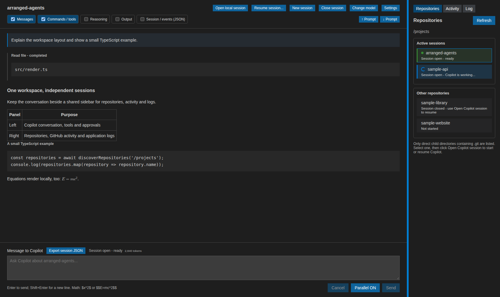

Workspace
=========

DevDash Agents opens as a single editor tab with two resizable panels:

* the selected repository's Copilot conversation on the left;
* a shared sidebar on the right with **Repositories**, **Github**, **Log** and **Settings** views.

   Two resizable panels, shown with illustrative demo data.

Drag the divider to resize the panels. The focused divider also responds
to the left and right arrow keys.

Repository discovery
--------------------

The right panel lists immediate child directories that contain a ``.git``
directory or file, including Git worktrees. Discovery is intentionally one level
deep and does not follow directory symlinks.

No Copilot process starts when the application opens. Selecting a repository
starts its session lazily and makes its activity and conversation visible.
Open or busy repositories move into **Active sessions**; the remaining entries
stay under **Other repositories**. Selection, open-session state and running work
have separate visual indicators.

Use **Refresh** to rescan the parent directory. Existing sessions remain open
when their repositories are still present. Switching repositories preserves
each conversation and unfinished draft.

Application logs
----------------

Use **Repositories**, **Github**, **Log** and **Settings** at the top of the right panel to
switch views. **Github** contains the selected repository's GitHub views;
switching sidebar views preserves their contents.
The log shows timestamped events across repositories: local model loading and
unloading, worker loading/ready/stopped states, model/device details, model
directory size (logical bytes including weights and tokenizer), startup
failures, switching to Copilot, and Copilot session and model changes.
Messages have no repository-name prefix. Events remain visible when switching
repositories. The latest 200 events are kept in memory until the application
closes; logs are not saved with conversation history.

Navigation
----------

Issue and pull request titles open a description and comment reader
in the main panel, with a button to return to the conversation. The chat's
**Show issue / PR** button returns to the open discussion without reloading it.
Comment and GitHub-backed commit links open in the external browser. Only
validated HTTP and HTTPS links are accepted. Command, script and local-file URL
schemes are blocked.

See :doc:`sessions` for session isolation and persistence, and
:doc:`github_activity` for the sidebar's **Github** view.
